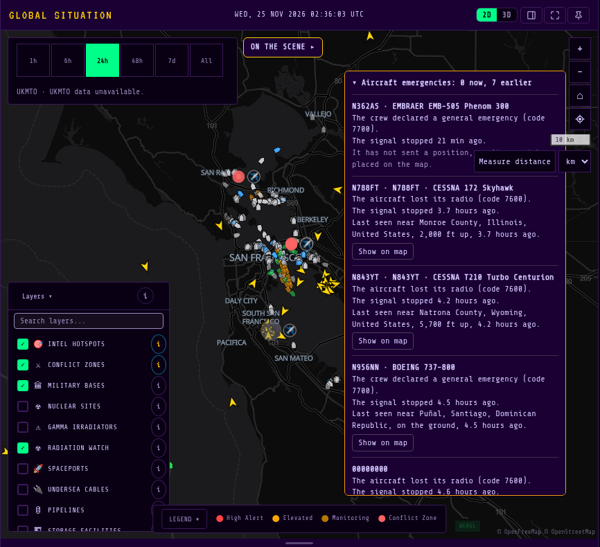
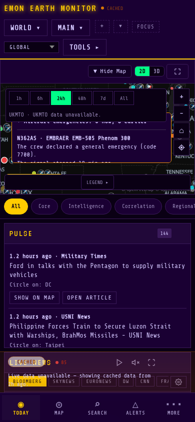

# EMON Earth Monitor

A live map of what is happening, **North America first**: planes and ships, severe weather and floods, wildfires,
earthquakes, traffic cameras, local and world news, markets and conflict, on one screen. Live at
**https://emon.alola.lol**.

EMON is a self-hosted, modified copy of [**World Monitor** by koala73](https://github.com/koala73/worldmonitor),
licensed **AGPL-3.0** like the original. This repository is EMON's complete source. World Monitor's own README is kept at
[docs/README.worldmonitor.md](docs/README.worldmonitor.md), and its self-hosting guide at [SELF_HOSTING.md](SELF_HOSTING.md).

<p>
  
  
</p>

## What is different from World Monitor

- **No accounts, no paid tier.** Sign In, Pro, Upgrade, pricing and the PRO badges are deleted in the code, and every
  feature is open to every visitor (`selfhost/unlock_pro.py`, `unlock_export.py`, `patch_mine.py`, `patch_mine2.py`,
  `patch_mine3.py`).
- **AI on your own machine.** Summaries, briefs and classifications run on a local [Ollama](https://ollama.com) model
  instead of a paid API (`selfhost/extras/local-ai/`).
- **North America first.** It opens on North America, with severe-weather alerts for the US and Canada, more cameras and
  news channels for SF, Oakland, Seattle, LA and Santa Cruz, and airport boards for the cities' main airports.
- **More on the map:** live planes and ships around the area you are looking at, aircraft declaring emergencies,
  current wildfire outlines, about 40,000 public traffic cameras, "On the scene" posts from the place on the map, a
  Pulse panel listing every flashing news location, and clickable conflict, fire and strike points with satellite
  pictures (`selfhost/patch_*.py`, `selfhost/selfhost-channels.js`).
- **Editions as paths** on one site, instead of one subdomain each.

### Editions

| Path | Edition |
| --- | --- |
| `/` | World |
| `/war` | War |
| `/weather` | Weather |
| `/tech` | Tech |
| `/finance` | Finance |
| `/commodity` | Commodity |
| `/energy` | Energy |

Each edition has its own tabs (missions) and its own map. `/good-news` (World Monitor's "Happy" edition) still loads if typed.

## How it runs

```
browser
  └─ reverse proxy (Caddy) on emon.<your-domain>
       ├─ /local/*      static JSON written by the feed scripts      (optional, selfhost/extras/pi-feeds)
       ├─ /camproxy/*   camproxy.py on 127.0.0.1:8931                 (optional, selfhost/extras/pi-feeds)
       └─ everything else → worldmonitor container (WM_PORT, 8960 on EMON's server)

docker compose (docker-compose.yml + docker-compose.override.yml)
  worldmonitor   World Monitor's published image: nginx + API. EMON mounts its own web build (selfhost/dist),
                 nginx template and selfhost-channels.js into it.
  ais-relay      ship (AIS), Telegram/X and news relay. EMON mounts selfhost/relay/ais-relay.cjs.
  redis          the data store.
  redis-rest     REST front for Redis. EMON mounts selfhost/redis-rest/redis-rest-proxy.mjs.
  wm-llm         optional: a tiny bridge from the app to Ollama on the host (selfhost/extras/local-ai).

host
  seeders        Node scripts that fetch the public data into Redis, on systemd timers (selfhost/systemd/tower).
  Ollama         optional, for the AI features.
```

The API server is World Monitor's published image, unchanged. EMON's changes are in the web app it serves (built
from this repo into `selfhost/dist`), the nginx template, the relay and REST-proxy files, and the add-ons in
`selfhost/selfhost-channels.js`. EMON's own server runs everything except the feed scripts on one Linux box. The feed
scripts and the Caddy front run on a second small one (a Raspberry Pi), but one machine is enough.

## Self-hosting

### Requirements

- Linux with **Docker** and **Docker Compose v2**.
- **Node.js 22.19 or newer** and npm on the host (the repo's `.nvmrc` says 24; EMON's server runs 26). This is for the build
  and the seeders.
- git, rsync and python3.
- A domain name, and a reverse proxy such as Caddy, if it should be reachable from outside.
- Optional: [Ollama](https://ollama.com) and a GPU for the AI features.

### 1. Get the code

```bash
git clone https://github.com/nviiiivn/emon.git
cd emon
npm ci
```

### 2. Make `.env`

`.env` sits in the repo root and is gitignored. Start with the four secrets World Monitor requires; Compose will not
start without them:

```bash
echo "RELAY_SHARED_SECRET=$(openssl rand -hex 32)" >> .env
echo "REDIS_PASSWORD=$(openssl rand -hex 32)"      >> .env
echo "REDIS_TOKEN=$(openssl rand -hex 32)"         >> .env
echo "WM_SESSION_SECRET=$(openssl rand -hex 32)"   >> .env
echo "WM_PORT=8960"                                >> .env
```

Then add EMON's own. Every variable is listed under [Keys and settings](#keys-and-settings) below.

```bash
# the operator key nginx adds to the AI and formerly-Pro routes, so they work without sign-in (never sent to browsers)
echo "WORLDMONITOR_VALID_KEYS=$(openssl rand -hex 32)" >> .env
```

### 3. Turn on EMON's container changes

```bash
cp selfhost/docker-compose.override.example.yml docker-compose.override.yml
```

The override mounts the EMON web build, nginx template, `selfhost-channels.js`, and the EMON relay and REST-proxy
files into World Monitor's containers. It also points the AI at the `wm-llm` bridge (step 7). If you skip the AI, the AI
panels say they are unavailable and everything else works.

### 4. Build the web app

```bash
sh selfhost/build.sh
```

This takes 10 to 20 minutes. It ends with `BUILD-OK` and leaves the site in `selfhost/dist`. The build also reads any
`VITE_*` settings from `.env`. `selfhost/build.sh` turns on `VITE_ENABLE_ORBITAL_WATCH` (satellite pictures in popups)
by itself.

The source in this repo already has every EMON change in it, so you do **not** run the `selfhost/patch_*.py` scripts.
They are the record of each change, in the order they were made: `patch_cams*.py`, `airports_block.py`,
`patch_flights.py`, `patch_variant_urls.py`, `nolinks.py`, `emon_block.py`, `editions.py`, `unhide.py`, `unlock_pro.py`,
`unlock_export.py`, `news_trim.py`, `patch_overlays.py`, `hidden_block.py` (Nov 19); `patch_planes.py`,
`patch_fires_boot.py`, `patch_tab_maps.py`, `patch_no_country_click.py`, `patch_flash_label*.py`, `patch_ships.py`,
`patch_globe_tiles.py` (Nov 20); `patch_pick.py`, `patch_poi.py` (Nov 21); `patch_pulse_panel.py`, `patch_mine.py`,
`patch_mine2.py`, `patch_mine3.py`, `unhide_mine3.py` (Nov 24). The newer ones skip what is already done. Re-applying
them to a newer World Monitor checkout has not been tried.

### 5. Start it

```bash
docker compose pull
docker compose up -d
```

Open `http://localhost:8960`. The map works at once. The panels fill as the seeders run (next step).

EMON was built against World Monitor's images as published on 2026-11-19 (`main`):

| Image | Digest |
| --- | --- |
| `ghcr.io/koala73/worldmonitor-selfhosted` | `sha256:27356ca55d331bee3335eb272220461dbea192580c7e4a3113bed208be0e6a35` |
| `ghcr.io/koala73/worldmonitor-ais-relay` | `sha256:bd2077a15d81310f1bd0c8200fdeff4c8a9bee92aa5903e078219116a39fee78` |
| `ghcr.io/koala73/worldmonitor-redis-rest` | `sha256:bd069a23a2174fa7fb03966e1135b3116567f0eab67adabeb9bff58857035ce2` |

`main` moves. If a newer image does not match this web build, pin these digests in `docker-compose.override.yml`
(`image: ghcr.io/koala73/worldmonitor-selfhosted@sha256:...`).

### 6. Fill it with data (seeders)

The seeders run on the host and write into Redis through `redis-rest` (127.0.0.1:8079). Run all of them once:

```bash
./scripts/run-seeders.sh
```

There are about 300, and a full pass takes about 3.5 hours. Some data expires sooner than that, so EMON runs the
short-lived ones on faster timers. To set them up as user services:

```bash
mkdir -p ~/.config/systemd/user ~/.local/bin
cp -r selfhost/systemd/tower/* ~/.config/systemd/user/
cp selfhost/bin/wm-seed-*.sh ~/.local/bin/ && chmod +x ~/.local/bin/wm-seed-*.sh
systemctl --user daemon-reload
systemctl --user enable --now worldmonitor-seed.timer worldmonitor-quick.timer worldmonitor-fast.timer \
  worldmonitor-weather.timer worldmonitor-social.timer worldmonitor-extra.timer
loginctl enable-linger "$USER"   # keep the timers running when you are logged out
```

| Timer | Every | Runs |
| --- | --- | --- |
| `worldmonitor-seed` | 30 min after the last pass ends | all seeders (`scripts/run-seeders.sh`) |
| `worldmonitor-quick` | 10 min | earthquakes, outages, military flights, news insights, correlation cards; security advisories and radiation hourly |
| `worldmonitor-fast` | 10 min | cross-source signals |
| `worldmonitor-weather` | 10 min | US / Canada / world weather alerts |
| `worldmonitor-social` | 15 min | Social Velocity (keyless Reddit archive) |
| `worldmonitor-extra` | 3 h | GPS jamming, grid disruption clock |

The units and scripts expect the repo at `~/projects/worldmonitor`. If yours is somewhere else, change that path in
`selfhost/bin/wm-seed-*.sh` and in `worldmonitor-seed.service`.

### 7. Local AI (optional)

EMON runs its own Ollama instance on `127.0.0.1:11436`, separate from any other Ollama on the machine, and a small
bridge so the app container can reach it:

```bash
# 1. a second Ollama for EMON (or use your main one and change 11436 in the two scripts below)
OLLAMA_HOST=127.0.0.1:11436 ollama serve &       # EMON's server runs this as a systemd service
OLLAMA_HOST=127.0.0.1:11436 ollama pull gemma4:12b

# 2. the host half of the bridge (unix socket -> Ollama), plus the "no thinking" helper the forecast seeders use
mkdir -p ~/services/wm-llm/sock
cp selfhost/extras/local-ai/host_relay.py selfhost/extras/local-ai/nothink_proxy.py selfhost/extras/local-ai/container_relay.js ~/services/wm-llm/
systemctl --user enable --now wm-llm-relay.service wm-llm-nothink.service

# 3. the container half, on the stack's network so the app reaches it as http://wm-llm:11434
docker run -d --name wm-llm --restart unless-stopped --network "$(basename "$PWD")_default" \
  -v ~/services/wm-llm/sock:/sock -v ~/services/wm-llm/container_relay.js:/relay.js:ro \
  node:22-alpine node /relay.js
```

The model is `OLLAMA_MODEL` in `.env` (default `gemma4:12b`). For the host seeders, set `LLM_API_URL` to the helper
(`http://127.0.0.1:11439/v1/chat/completions`) and `LLM_MODEL`.

### 8. Put it on a domain

Put a reverse proxy in front. [selfhost/extras/pi-feeds/Caddyfile.example](selfhost/extras/pi-feeds/Caddyfile.example)
is EMON's own front server with the hostname changed.

**Use a hostname that starts with `emon.`** (for example `emon.example.com`). The add-ons in
`selfhost/selfhost-channels.js` check for it, and on other hostnames you get World Monitor's own settings for those
parts. The page's link previews and search-engine data name `emon.alola.lol`. To use your own address there, replace
it in `index.html`, `src/config/variant-meta.ts`, `src/config/variant-dashboard-html.ts` and the two `sub_filter` lines
of `selfhost/nginx.conf.template`, then rebuild and run `docker compose up -d`.

### 9. Extra feeds (optional)

`selfhost/extras/pi-feeds/` holds the scripts behind `/local/*` and `/camproxy/*`:

| Script | Writes / serves | Schedule (EMON's server) |
| --- | --- | --- |
| `flights.py` | `~/www/emon-local/flights.json`: departure boards for the focus cities' airports (OpenSky) | every 2 h |
| `fire_perimeters.py` | `~/www/emon-local/fire-perimeters.json`: current wildfire outlines (NIFC, keyless) | every 30 min |
| `news_local.py` | `~/www/emon-local/news-local.json`: local headlines per city | every 30 min |
| `cams.py` (+ `build_cams.py`) | `~/www/emon-local/cams.json`: about 40,000 public traffic cameras | daily 04:40 |
| `camproxy.py` | HTTP on 127.0.0.1:8931: plane and ship lookups, aircraft emergencies, camera snapshots, satellite pictures | always on |

Their systemd units are in `selfhost/systemd/pi/`. They expect the scripts in `~/services/emon-feeds/` (and
`flights.py` in `~/services/emon-flights/`), plus `build_cams.py` at `~/projects/emon/build_cams.py`. Serve
`~/www/emon-local` at `/local/` as in the Caddyfile example.

`camproxy.py` reads settings from an environment file (see the comment in `emon-camproxy.service`):

- `CDSE_CLIENT_ID` and `CDSE_CLIENT_SECRET` (optional): a free [Copernicus Data Space](https://dataspace.copernicus.eu)
  account, used for the Sentinel-2 close-up pictures. Without it you get only NASA's wide view.
- `EMON_AIS_STATIC_SSH` (optional): `user@host` of the machine running the stack, if it is a different machine. It is used
  to read the ship details the EMON relay writes to `selfhost/nvii-data/ais-static.json`. `EMON_AIS_STATIC_PATH` sets
  that file's path if your checkout is not `~/projects/worldmonitor`.

## Keys and settings

Names only. The values go in `.env` (or a systemd environment file) and never in the repo. World Monitor's full list,
with sign-up links, is in [SELF_HOSTING.md](SELF_HOSTING.md#-api-keys) and `.env.example`.

**Required by Compose**

| Name | What it is for |
| --- | --- |
| `RELAY_SHARED_SECRET` | the app ↔ relay shared secret |
| `REDIS_PASSWORD` | Redis password |
| `REDIS_TOKEN` | token for `redis-rest`; the seeders use it too |
| `WM_SESSION_SECRET` | signs anonymous browser sessions (32+ characters) |

**EMON**

| Name | Required? | What it is for |
| --- | --- | --- |
| `WORLDMONITOR_VALID_KEYS` | yes, for the AI and the formerly-Pro panels | the operator key; nginx adds it on those routes (as `LOCAL_API_TOKEN`) |
| `WM_PORT` | no (default 3000) | host port of the app; EMON uses 8960 |
| `WM_IMAGE_TAG` | no (default `main`) | World Monitor image tag |
| `OLLAMA_MODEL` | no (default `gemma4:12b`) | model for the AI features |
| `LLM_API_URL`, `LLM_MODEL` | no | AI for the host seeders (forecasts, briefs); point at the `nothink_proxy.py` helper |
| `WORLDMONITOR_SEED_REFRESH_KEY` | no | lets seeders (such as `seed-resilience-scores.mjs`) make the API rebuild cached results; any `openssl rand -hex 32` value, the same in `.env` for both |
| `VITE_ENABLE_ORBITAL_WATCH` | build-time; `selfhost/build.sh` sets it | satellite pictures in map popups |
| `ORBITAL_WATCH_ENABLED` | set in the override | server half of the same feature |

**Data sources (all optional; each one fills more panels)**

| Name | Source | Fills |
| --- | --- | --- |
| `NASA_FIRMS_API_KEY` | NASA FIRMS (free) | fire detections |
| `CLOUDFLARE_API_TOKEN` | Cloudflare Radar (free) | internet outages |
| `AISSTREAM_API_KEY` | aisstream.io (free) | live ships |
| `OPENSKY_CLIENT_ID`, `OPENSKY_CLIENT_SECRET` | OpenSky (free account) | flights, at higher rate limits |
| `FRED_API_KEY`, `EIA_API_KEY` | FRED, EIA (free) | economy and energy panels |
| `FINNHUB_API_KEY`, `ALPHA_VANTAGE_API_KEY` | Finnhub, Alpha Vantage (free tiers) | markets |
| `ACLED_EMAIL` + `ACLED_PASSWORD`, or `ACLED_ACCESS_TOKEN` | ACLED | conflict and unrest events |
| `UCDP_ACCESS_TOKEN` | UCDP | conflict events (relay) |
| `AVIATIONSTACK_API` | AviationStack (free tier) | airport delays |
| `X_BEARER_TOKEN`, `X_CURATED_LIST_ID` | X API (paid) | the X panel; empty without it |
| `TELEGRAM_API_ID`, `TELEGRAM_API_HASH`, `TELEGRAM_SESSION` | a Telegram account | the Telegram panel; empty without it |
| `EXA_API_KEYS`, `FIRECRAWL_API_KEY` | Exa, Firecrawl (paid) | Grocery Basket; empty without them |

Not set up on EMON: Consumer Prices. It needs World Monitor's separate `consumer-prices-core` service and a Postgres
database. The relay's X and Telegram keys have to be passed in the override; SELF_HOSTING.md shows how.

## Updating

```bash
git pull
npm ci
sh selfhost/build.sh                 # swaps the new site into selfhost/dist; no restart needed
docker compose up -d                 # only if the override or .env changed
```

Run `docker compose pull` only when moving to newer World Monitor images, and rebuild after it. If the timer units or
scripts changed, copy them again and run `systemctl --user daemon-reload`.

## Layout

| Path | What is there |
| --- | --- |
| `src/`, `index.html`, `vite.config.ts` | the web app, with EMON's changes applied |
| `selfhost/build.sh` | build the web app into `selfhost/dist` |
| `selfhost/docker-compose.override.example.yml` | EMON's container changes (copy to `docker-compose.override.yml`) |
| `selfhost/nginx.conf.template` | the image's nginx template, plus the AI-key, rate-limit and naming blocks |
| `selfhost/selfhost-channels.js` | EMON add-ons that run in the page (editions menu, tabs, North America setup, theme, map extras) |
| `selfhost/relay/`, `selfhost/redis-rest/` | the relay and REST-proxy files EMON runs, next to the untouched `*.from-image.*` copies |
| `selfhost/patch_*.py`, `unlock_*.py`, `*_block.py` | the record of every EMON change (already applied in `src/`) |
| `selfhost/systemd/tower/`, `selfhost/bin/` | the seeder and local-AI services and timers |
| `selfhost/systemd/pi/`, `selfhost/extras/pi-feeds/` | the extra feeds, their services and the Caddy example |
| `selfhost/extras/local-ai/` | the Ollama bridge and the no-thinking helper |

## License

AGPL-3.0, the same as World Monitor ([LICENSE](LICENSE)). If you run a modified copy for other people, the AGPL asks you
to offer them its source code. EMON's footer links here for that reason.

Built on [koala73/worldmonitor](https://github.com/koala73/worldmonitor) (AGPL-3.0). All credit for the original
dashboard goes to its authors.
